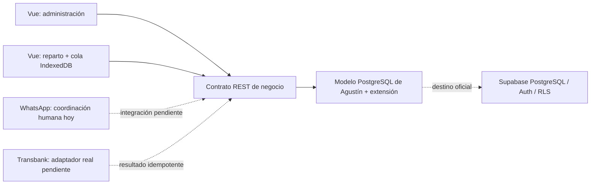

# Arquitectura y contratos — PBI 53

En desarrollo el contrato se ejecuta en Node/HTTP y el SQL en PGlite, sobre archivos en `.local/postgres`. La interfaz no usa el store de demostración original para autorizar ni cambiar inventario. La instancia se vincula exclusivamente a `127.0.0.1` y solo guarda datos de ejemplo.

## Contratos REST

Todas las rutas de negocio requieren sesión. Los errores devuelven `{error}` y estado HTTP 400 (datos), 401 (sesión), 403 (perfil), 404 (registro) o 409 (conflicto/regla). Una transacción falla completa, sin guardar movimientos parciales.

| Ruta | Método | Perfil / operación |
| --- | --- | --- |
| `/api/auth/login`, `/auth/me`, `/auth/logout` | POST, GET, POST | Acceso local, consulta y revocación |
| `/api/clients`, `/clients/:id` | GET/POST, GET/PATCH | Administrador/administrativo; duplicados por teléfono/RUT; ficha y último pedido |
| `/api/addresses`, `/addresses/:id` | POST/PATCH | Alta/actualización; no trasladar dirección a otro cliente |
| `/api/orders`, `/orders/:id` | POST/GET | Crear pedido/detalle e historial |
| `/api/orders/:id/authorize` | POST | Solo administrativo; `CON_RETORNO` o `SIN_RETORNO` y motivo |
| `/api/payments`, `/payments/:id/validate` | POST | Referencia, medio y monto; confirmar/rechazar con autor/fecha |
| `/api/vehicles`, `/vehicles/:id` | POST/PATCH/DELETE | Capacidades, edición y desactivación preservando historial |
| `/api/turns`, `/turns/:id/vehicle`, `/start`, `/close` | POST | Planificación, carga atómica y descarga/continuidad |
| `/api/stops/:id/deliver` | POST | Chofer de la ruta: cantidades, aceptación parcial, ausencia y evento único |
| `/api/returns/:id/collect`, `/writeoff` | POST | Chofer de la ruta / administrador después de 60 días |
| `/api/inventory/:id/classify` | POST | Clasificación administrativa de reporte roto |
| `/api/inventory/0/writeoff`, `/fill`, `/initial` | POST | Solo administrador, motivos y confirmación física para baja |
| `/api/state` | GET | Snapshot restringido por perfil; mensaje interno únicamente administrativo |

## Permisos

| Operación | Administrador | Administrativo | Chofer |
| --- | --- | --- | --- |
| Clientes/direcciones/pedidos/pagos | Sí | Sí | No |
| Nota de no retornados y autorización de nuevo pedido | No | Sí | No |
| Clasificar roto informado | Sí | Sí | No |
| Baja definitiva e ingreso/embotellación | Sí | No | No |
| Planificar ruta/vehículo/carga | Sí | Sí | No |
| Entregar/retirar/reportar | No | No | Solo su turno |

## Fallos de integración

- **Webpay:** esta copia registra una simulación identificada; no genera enlaces de pago reales, no cobra y no presenta una simulación como confirmación externa. En Supabase se deberá validar el resultado de Transbank en servidor y conservar evento/transacción única. Un rechazo/reintento no libera dos veces el pedido.
- **WhatsApp:** la coordinación es humana; la app conserva motivo/autorización. El adaptador futuro necesita número, permisos y plantillas; un fallo de envío no supone aceptación del cliente ni modificación de stock.
- **Geografía:** se ordenan coordenadas reales guardadas en las direcciones (latitud/longitud), con ubicaciones faltantes al final. Esto es orden geográfico básico; no se declara optimización vial. El enlace Maps permite revisar la dirección.
- **Sin conexión:** el chofer mantiene su última ruta local y almacena entregas/retiros en IndexedDB con evento único. El servidor valida al recuperar conexión; conflictos permanecen visibles. No se cachean sesiones ni pagos en el service worker. Un registro en cola no se muestra como confirmado por el servidor.
- **Datos:** consultas parametrizadas; transacciones para inventario/pago/entrega; libro inmutable y saldos no negativos. No se ejecutan DROP en cada arranque.

## Integración oficial con Supabase

El proyecto Supabase del equipo no está accesible en el conector de esta sesión. Se debe importar la **estructura** del modelo y la extensión en una base de desarrollo nueva, sin ejecutar el script de demostración destructivo sobre datos reales. Sustituir el acceso local por Supabase Auth y asignar perfiles mediante datos controlados por servidor (app_metadata o tabla protegida), habilitar RLS en cada tabla expuesta y proteger columnas/notas internas. No usar user_metadata ni service_role en el frontend. Las vistas también deben respetar RLS. Esta integración exige pruebas independientes antes de considerarse terminada.

Referencia consultada: [desarrollo local de Supabase](https://supabase.com/docs/guides/local-development), [autenticación por contraseña](https://supabase.com/docs/guides/auth/passwords). El changelog se revisó; la desactivación futura de cifrados TLS antiguos no afecta al adaptador de loopback ni a clientes actuales de navegador.
